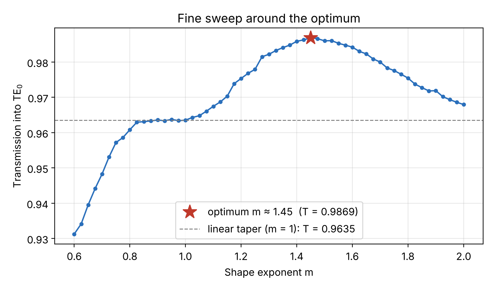
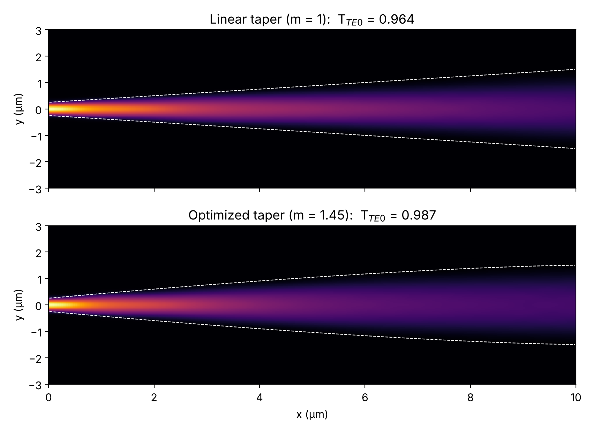

# SOI Waveguide Taper Shape Optimization with Ansys Lumerical

Optimization of a silicon waveguide taper using **Ansys Lumerical MODE (2.5D varFDTD)** for a fast shape sweep and **Lumerical FDTD (3D)** as a full-vector check, both driven from Python through `lumapi`.


## Problem

Widen a 220 nm SOI waveguide from 0.5 µm to 3.0 µm over 10 µm with as little loss as possible. The taper edge follows a one-parameter power law:

```
w(x) = w_out − (w_out − w_in) · (1 − x/L)^m ,   0 ≤ x ≤ L
```

`m = 1` is linear, `m > 1` widens fastest near the narrow end, `m < 1` near the wide end. The figure of merit is the power transmitted into the fundamental TE mode of the output waveguide.

## Workflow

```
lumerical/taper_sweep_varfdtd.py   varFDTD sweep of m (coarse, then fine around the best)  ->  data/sweep_varfdtd.csv
lumerical/taper_check_fdtd3d.py    3D FDTD of the best taper vs a linear taper              ->  data/fdtd3d_check.csv
analysis/plot_results.py           figures                                                  ->  images/
lumerical/taper_geometry.py        shared taper definition
```

- **varFDTD** collapses the 220 nm slab into effective indices and solves in 2D, so each taper takes a fraction of the 3D time and a whole sweep is practical.
- **Measurement:** a mode source in the input waveguide, a power monitor and a mode-expansion monitor in the output waveguide, 1.55 µm.
- **3D FDTD** re-simulates the optimum and the linear taper with full 3D geometry to validate the 2.5D result.

## Run

Requirements: Ansys Lumerical (MODE and FDTD) with the Python API, Python 3.8+, `numpy`, `matplotlib`.

```bash
pip install -r requirements.txt
cd lumerical
python taper_sweep_varfdtd.py --hide       # sweep (edit ranges with --m-min, --m-max, --n-coarse, --n-fine)
python taper_check_fdtd3d.py --hide        # 3D FDTD check (slow; uses the best m from the sweep)
cd ../analysis
python plot_results.py                     # figures -> ../images
```

If `lumapi` is not importable, set `LUMAPI_PATH` to Lumerical's `api/python` folder. Geometry (widths, length, wavelength) is defined once in `lumerical/taper_geometry.py`.

## Results

Generated into `images/` by `analysis/plot_results.py`:


## Analytical cross-check

`reference_model/` contains an independent 2D eigenmode-expansion model in Python (effective-index slab, scalar TE), used to understand what to expect from the sweep. For the same geometry it finds an optimum near **m ≈ 1.45** with 98.7 % transmission into TE₀, against 96.4 % for a linear taper, and shows that the best exponent depends on the taper length.




It is a cross-check for trends, not a substitute for the Lumerical results.

## Limitations

- Results depend on mesh settings and simulation time; check convergence (e.g. refine the mesh and re-run the optimum) before quoting numbers.
- The sweep optimizes one shape parameter at one wavelength and one length. Re-run it when those change.
- Lumerical property names can differ slightly between versions. The scripts report any property they could not set (`[warning] ...`) instead of failing silently; adjust those names to match your version's object properties. The mode-expansion result name used to read TE₀ power may also need adjusting, in which case the scripts fall back to total transmitted power.

## Acknowledgement

The idea of finding the best taper by sweeping the exponent of a power-law profile follows the Ansys Lumerical tutorial *"Curved waveguide taper (varFDTD and FDTD)"*: https://optics.ansys.com/hc/en-us/articles/360042799713-Curved-waveguide-taper-varFDTD-and-FDTD

The scripts, geometry, parameters, analysis, text and figures in this repository are my own.

## Author

Ripon Kumar Dey, PhD
